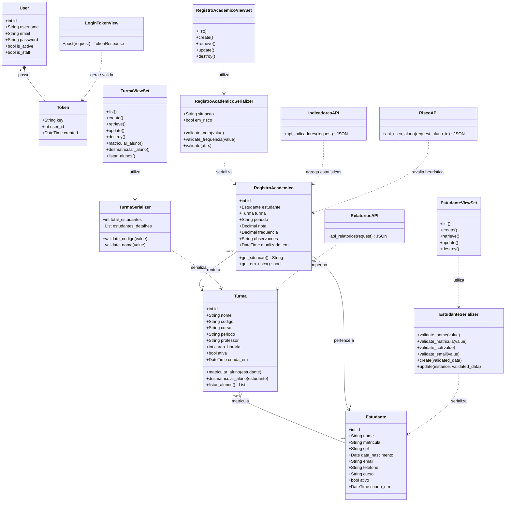

# Modelagem UML Atualizada — SIMPA

Este documento apresenta os diagramas de **Casos de Uso** e de **Classes** atualizados para refletir com fidelidade a arquitetura real implementada no backend Django (`SIMPA/django_backend`), cobrindo os requisitos **RF01**, **RF02**, **RF03**, **RF04**, **RF07**, **RF08** e **RF09**.

---

## 1. Diagrama de Casos de Uso (UML)

```mermaid
flowchart TD
    subgraph Atores
        Admin["👤 Administrador / Coordenador"]
        Professor["👨‍🏫 Professor / Docente"]
        Aluno["🎓 Aluno / Estudante"]
        Moodle["🌐 Sistema AVA (Moodle)"]
    end

    subgraph SIMPA["SIMPA — Sistema Inteligente de Monitoramento e Predição Acadêmica"]
        UC01["UC01: Autenticar no Sistema (E-mail/Usuário + Senha)"]
        UC02["UC02: Obter / Revogar Token de Acesso (DRF Token Auth)"]
        UC03["UC03: Gerenciar Alunos (CRUD, Validação de CPF e Matrícula)"]
        UC04["UC04: Gerenciar Turmas e Disciplinas (CRUD)"]
        UC05["UC05: Matricular / Desmatricular Aluno em Turma"]
        UC06["UC06: Lançar e Consultar Registros Acadêmicos (Notas e Faltas)"]
        UC07["UC07: Consultar Indicadores e Estatísticas Descritivas"]
        UC08["UC08: Visualizar Dashboard e Relatórios de Desempenho"]
        UC09["UC09: Consultar Predição e Motivos de Risco Acadêmico"]
        UC10["UC10: Sincronizar Dados do AVA via Web Scraping"]
    end

    Admin --> UC01
    Admin --> UC02
    Admin --> UC03
    Admin --> UC04
    Admin --> UC05
    Admin --> UC06
    Admin --> UC07
    Admin --> UC08
    Admin --> UC09

    Professor --> UC01
    Professor --> UC02
    Professor --> UC05
    Professor --> UC06
    Professor --> UC07
    Professor --> UC09

    Aluno --> UC01
    Aluno --> UC08
    Aluno --> UC09
    Aluno --> UC10

    UC01 -.->|<<include>>| UC02
    UC09 -.->|<<include>>| UC07
    UC10 <-- Moodle
```

### Detalhamento dos Casos de Uso

| Caso de Uso | Requisito | Descrição | Atores |
|---|---|---|---|
| **UC01 / UC02** | RF08 | Login via token simples do DRF (`/api/auth/token/`), logout (`/api/auth/logout/`) e proteção de endpoints via header `Authorization: Token <key>`. | Todos |
| **UC03** | RF01 | Cadastro, listagem, atualização e exclusão de alunos com validação de CPF (algoritmo da Receita Federal), matrícula única e e-mail. | Admin |
| **UC04** | RF02 | Cadastro de disciplinas/turmas com código único, carga horária e período letivo. | Admin, Professor |
| **UC05** | RF02 | Associação Many-to-Many entre Turmas e Estudantes (`/api/turmas/{id}/matricular/`). | Admin, Professor |
| **UC06** | RF03, RF07 | Lançamento e consulta de notas (0 a 10) e frequência (0 a 100%), cálculo automático de situação e validação de unicidade. | Admin, Professor |
| **UC07** | RF04, RF05 | Cálculo de média, mediana, desvio-padrão, mínimos, máximos e taxa de aprovação via `/api/indicadores/`. | Admin, Professor |
| **UC08** | RF06, RF07 | Consulta consolidada de turmas, alunos e desempenho acadêmico via `/api/relatorios/` e painel web. | Todos |
| **UC09** | RF09 | Avaliação de score de risco (0-100), classificação (Baixo, Médio, Alto) com motivos e recomendações via `/api/risco/{id}/`. | Todos |
| **UC10** | RF13 | Extração e sincronização automatizada com Moodle via `moodle_scraper.py`. | Aluno, Admin |

---

## 2. Diagrama de Classes (Estrutura Real do Sistema)



---

## 3. Conformidade com os Requisitos do Projeto

1. **RF01 (Cadastro de Aluno):** A classe `Estudante` possui validações de integridade no `EstudanteSerializer` (com checagem algorítmica de CPF, unicidade de matrícula e formato de e-mail).
2. **RF02 (Cadastro de Turma/Disciplina):** A classe `Turma` gerencia a disciplina ofertada e o relacionamento Many-to-Many com `Estudante`, com endpoints dedicados para matricular e desmatricular alunos.
3. **RF03 / RF04 / RF05 / RF06 (Registros e Indicadores):** `RegistroAcademico` valida intervalo de notas (0 a 10) e frequência (0 a 100%), calculando médias, medianas, desvios e relatórios consolidados.
4. **RF07 (API REST):** ViewSets e controladores HTTP mapeados com métodos padrão (GET, POST, PUT, PATCH, DELETE) retornando códigos de status padronizados (200, 201, 204, 400, 401, 404).
5. **RF08 (Autenticação por Token):** Implementada via `rest_framework.authtoken` com geração de token no login (`/api/auth/token/`), revogação no logout e autorização obrigatória nos endpoints protegidos via cabeçalho `Authorization: Token <key>`.
